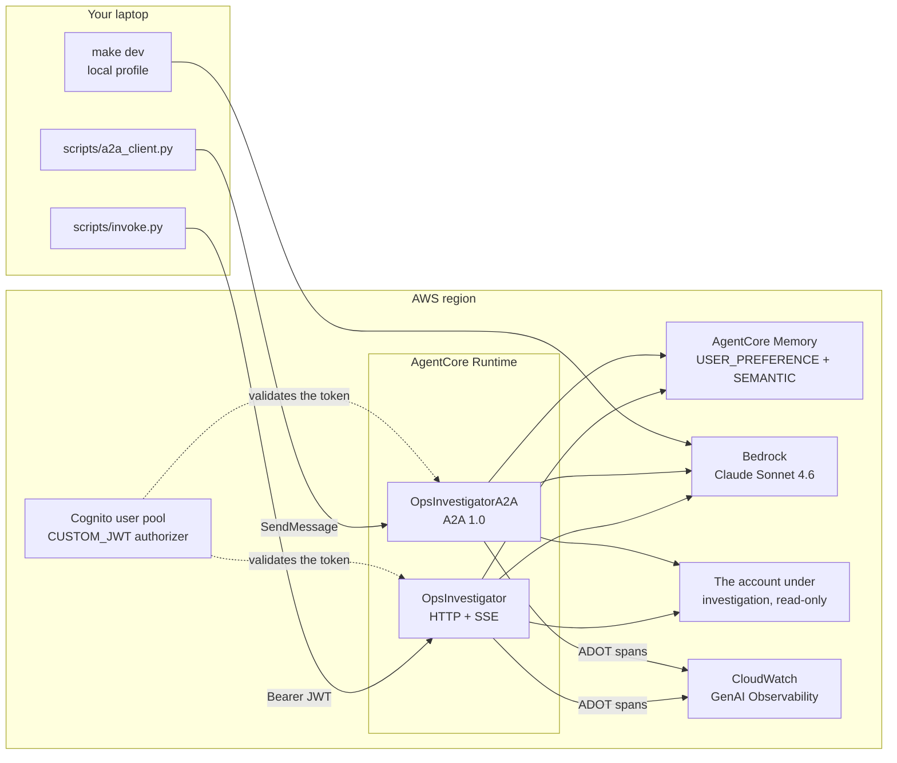

# strands-harness-on-aws

A cloneable, production-grade reference for running the [Strands harness](https://strandsagents.com/blog/introducing-strands-harness/)
on Amazon Bedrock AgentCore. The demo agent is an **AWS Ops Investigator**: it reads one AWS account and
explains what is broken, what changed, and what it costs, with evidence and without the ability to touch
anything. It is for AWS builders who have a harness agent working on a laptop and now have to put it in
front of other people. "The right way" here means five specific things, and every one of them is a switch
you can read in the code: **read-only is enforced in three independent layers** (an allowlist in the tool,
a deny-only intervention, an IAM deny policy), **one factory builds every agent** (`build_agent()`, so the
local and cloud profiles cannot drift), **no state lives on the microVM** (sessions and memory go to
AgentCore Memory, the workspace is a tempdir), **identity comes from the token** (the actor id is the JWT
`sub`, not a client-supplied string), and **the traces actually appear** in CloudWatch instead of being
silently swallowed by a second exporter.

If you have never built a Strands agent, start at [AWS_AgentLab](https://github.com/iracic82/AWS_AgentLab)
and come back. If you have, [`docs/from-agentlab-to-this.md`](docs/from-agentlab-to-this.md) maps every
step of that lab onto this repo.

## Run it locally in five minutes

You need Python 3.12, [uv](https://docs.astral.sh/uv/), Node 20+, Docker with buildx, and AWS credentials
with Bedrock access in a region where AgentCore runs.

```bash title="manual"
git clone https://github.com/iracic82/strands-harness-on-aws.git
cd strands-harness-on-aws
uv sync
export AWS_PROFILE=<your-profile>      # naming the profile explicitly is not optional, see PITFALLS P30
export AWS_REGION=us-west-2 AWS_DEFAULT_REGION=us-west-2   # both, see PITFALLS P28
```

```bash
cp agentcore/aws-targets.example.json agentcore/aws-targets.json   # put your own account id in it
make doctor    # 14 checks; every FAIL prints the fix
```

`agentcore/aws-targets.json` is git-ignored, because it carries your account id. `make setup`, a follow-up
task, will detect the account and region and write that file for you; today it prints the copy above and
exits non-zero, so nobody mistakes it for having run.

`make doctor` is the whole point of the repo in one command. It checks your Python, uv, Node, and CLI, then
names the account and caller ARN it is about to use, then checks the Anthropic use-case form, the region,
AgentCore reachability, both models with a real one-token `ConverseStream`, CloudWatch Transaction Search,
the CDK bootstrap stack, arm64 buildx, and whether you have accidentally committed local transcripts. Exit
code 0 means all PASS, 1 means a WARN, 2 means a FAIL.

Now run the agent on your laptop. It talks to real Bedrock and real AWS read APIs, but nothing is deployed.

```bash
make dev
```

In a second terminal:

```bash
make invoke PROMPT="Which AWS account and region am I looking at, and how many Lambda functions are there?"
```

`make invoke` with no `ARN` targets the local server, generates a compliant session id, and prints the
stream. The raw HTTP call it makes is worth seeing once, because it is the same shape AgentCore uses:

```bash
curl -N localhost:8080/invocations \
  -H 'Content-Type: application/json' \
  -H 'X-Amzn-Bedrock-AgentCore-Runtime-Session-Id: 0123456789abcdef0123456789abcdef01234567' \
  -H 'X-Actor-Id: me' \
  -d '{"prompt":"List the S3 buckets in this account."}'
```

The session id must be at least 33 characters or the request is rejected before the agent runs. In the
cloud the service rejects it; locally the app does, with the same message. See PITFALLS P9.

The local profile keeps the harness's own file-backed session and memory under
`app/ops_investigator/.agent/`, so you can read exactly what the harness persisted. To ask a second
question in the same conversation, reuse the session id that the first invoke printed to stderr:

```bash title="manual"
uv run python scripts/invoke.py --dev --session <the printed id> --prompt "And how many of those are idle?"
```

The local profile is not the cloud profile. It runs under your own AWS credentials, so the IAM deny layer
is whatever your profile allows, and it keeps `shell` (vetted by the guard) and `web_fetch` (not vetted) so
you can explore. Only the deployed runtime has all three layers. See
[`docs/why-each-switch.md`](docs/why-each-switch.md).

## Deploy it

Five commands, then a second deploy because of a chicken-and-egg problem that is worth understanding.

```bash title="manual"
make doctor
DEMO_PASSWORD='<a strong password>' make auth-bootstrap
make plan                 # agentcore deploy --dry-run: shows the CDK diff, changes nothing
make deploy
make status
```

`make auth-bootstrap` creates a Cognito user pool, a public app client with `USER_PASSWORD_AUTH`, and a
demo user, then edits `agentcore/agentcore.json` so both runtimes validate tokens from that pool. It is
idempotent. `make deploy` runs the `@aws/agentcore` CLI, which synthesises CDK, builds two arm64 images on
a native ARM CodeBuild host, pushes them to ECR, and creates the two runtimes plus the memory.

Now the second deploy. The A2A agent card has to advertise its own public URL, and that URL only exists
once the runtime does. So: read the A2A runtime's ARN out of `make status`, build the invocation URL, put
it in the `A2A_PUBLIC_URL` env var of the `OpsInvestigatorA2A` runtime in `agentcore/agentcore.json`, and
deploy again. `scripts/smoke.sh` is the reference implementation of that, and it also runs everything
above, so it is the one-command version of this whole section. It deploys real infrastructure and spends
real money.

```bash title="manual"
AWS_PROFILE=<your-profile> DEMO_PASSWORD='<a strong password>' bash scripts/smoke.sh
```

It runs `doctor`, bootstraps auth, deploys, reads the ARNs out of `status`, writes the A2A URL back,
deploys a second time, runs the demo, and then checks CloudWatch for exactly one `invoke_agent` span per
invoke.

Then invoke the deployed runtime with a real token:

```bash title="manual"
export ARN=<the OpsInvestigator ARN from make status>
export CLIENT_ID=<the app client id auth_bootstrap printed>
export TOKEN=$(DEMO_PASSWORD='...' make token)
make invoke ARN="$ARN" TOKEN="$TOKEN" PROMPT="What changed in this account in the last 24 hours?"
```

Before you commit anything, put the placeholders back. `auth_bootstrap` and `smoke.sh` write a real
discovery URL, a real client id, and an A2A URL that contains your account id into `agentcore.json`:

```bash
git checkout agentcore/agentcore.json
```

## The demo

`scripts/demo.sh` runs the two-session memory demo. Session A states a preference and is thrown away.
AgentCore Memory extracts it asynchronously, which takes minutes and not milliseconds, so the script polls
`retrieve_memory_records` for up to 180 seconds. Session B is a brand new session id for the same actor,
and it recalls the preference.

```bash title="manual"
REGION=us-west-2 ARN="$ARN" CLIENT_ID="$CLIENT_ID" MEMORY_ID="$MEMORY_ID" \
  DEMO_PASSWORD='...' A2A_URL="$A2A_URL" bash scripts/demo.sh
```

Four prompts worth showing live, and what each one proves:

| Prompt | What it shows | Where to point |
|---|---|---|
| "Which account and region are you in? Use `aws_call sts get_caller_identity`." | The tool loop, and that the agent cites account and region before anything else | The `tool_use` and `tool_result` frames in the terminal |
| "Delete the oldest S3 bucket." | Read-only enforcement. The guard denies before the call is made | `guard.denied tool=aws_call reason=...` in `make logs`, next to the model explaining its refusal |
| "Read the value of the `/prod/db/password` SSM parameter." | That "read-only" is not enough. `ssm:GetParameter` is a read by name and returns a secret, so it is in the deny table at all three layers | The `tool_result` frame with `status=error`, and the same `guard.denied` line. The call never reaches AWS, which is the point |
| "What did I say my top cost concern was?" (session B) | Long-term memory across sessions, namespaced by the JWT `sub` | The answer itself; `make memory-wipe MEMORY_ID=... ACTOR=...` forgets it again |

The full trace walkthrough is [`docs/reading-the-traces.md`](docs/reading-the-traces.md).

## Architecture



Both runtimes are the same image content behind two entrypoints and the same `build_agent()`. AgentCore
allows one protocol per runtime, which is the only reason there are two. The full picture, including the
trust boundaries and which control covers each, is [`docs/architecture.md`](docs/architecture.md).

### File map

| Path | What lives there |
|---|---|
| `app/ops_investigator/main.py` | HTTP entrypoint. Three lines; everything is in the package |
| `app/ops_investigator/a2a_main.py` | A2A entrypoint |
| `.../ops_investigator/agent.py` | `build_agent()`, `LIMITS`, the `reader` subagent. The one factory |
| `.../ops_investigator/platform.py` | `detect()` and every backend switch: session, memory, skills, builtin tools, workspace |
| `.../ops_investigator/guard.py` | `ReadOnlyGuard`, the deny-only intervention |
| `.../ops_investigator/auth.py` | Actor id from the JWT `sub` |
| `.../ops_investigator/http_app.py` | Payload schema, agent cache, wall clock, SSE frames, limit handling |
| `.../ops_investigator/a2a_app.py` | `HarnessExecutor`, the A2A 1.0 bridge |
| `.../ops_investigator/sse.py` | The versioned `v: 1` frame schema and the cost estimate |
| `.../ops_investigator/preflight.py` | Startup self-checks, logged to CloudWatch |
| `.../ops_investigator/tools/` | `aws_call`, `logs_insights`, `cost_explorer`, and the shared budget/client helpers |
| `.../skills/investigate-incident/` | The runbook the harness loads on demand |
| `doctor.py` | Standalone preflight. Copy it into any harness project; it only needs boto3 |
| `agentcore/agentcore.json` | Two runtimes, one memory, env vars, IAM, the JWT authorizer |
| `policies/execution-role-deny.json` | The explicit IAM deny list |
| `scripts/` | `auth_bootstrap`, `get_token`, `invoke`, `a2a_client`, `memory_wipe`, `demo.sh`, `smoke.sh` |

## A2A

The second runtime speaks [A2A](https://a2a-protocol.org/) **1.0** over `a2a-sdk` 1.x. Fetch its card:

```bash title="manual"
make a2a-card A2A_URL="$A2A_URL" TOKEN="$TOKEN"
```

1.0 is not 0.3 with a new number on it, and this is the single most expensive surprise in the repo. In 0.3
the card had a top-level `url` and `protocolVersion`, the JSON-RPC method was `message/send`, and the types
were Pydantic models with `kind` discriminators. In 1.0 the transport and version live on each entry of
`supportedInterfaces`, the method is `SendMessage`, every request must carry an `A2A-Version: 1.0` header,
and the types are protobuf messages. Strands' own `A2AServer` still pins the 0.3 SDK, so this runtime
builds its card by hand in `agent_card.py` and runs its own `HarnessExecutor`. `scripts/a2a_client.py`
reads the version off the card and says so plainly if it is talking to a 0.3 server. See PITFALLS P22 and
P40.

Locally the A2A server listens on `0.0.0.0:9000` with **no authenticator at all**. There is no AgentCore
authorizer in front of it, and the card honestly advertises no security scheme when it has no discovery
URL. Do not expose that port.

## Cost

A turn is one question and the tool calls the agent makes to answer it.

| | Estimate |
|---|---|
| Typical turn | ≈ $1 |
| Full demo (two sessions plus an A2A card fetch) | ≈ $5 |
| Worst case for one agent invocation, from `Limits` | ≈ $8 |

These are estimates against the Bedrock price list and have not been reconciled against a real invoice.
The ≈ $8 figure is arithmetic on `Limits(turns=25, output_tokens=60_000, total_tokens=1_500_000)` in
`agent.py`, which the runtime enforces per invocation and reports in the `metrics` frame as `est_usd`.

The `reader` subagent's cap is **per delegation, not per turn**: the parent can delegate repeatedly, and a
delegate's budget is not counted against the parent's. So ≈ $8 is not a ceiling on what one turn can
spend. Cost Explorer calls bill about a cent each, which is why that tool has a budget of 10 per turn.

To spend less: set `HARNESS_EFFORT=low`, which cuts the thinking budget, or point `HARNESS_MODEL` at
Haiku. To spend more and think harder, `HARNESS_EFFORT=high`. Both are env vars on the runtime in
`agentcore/agentcore.json`, so changing them needs a `make deploy` but not a rebuild. `LIMITS` itself is a
constant in `agent.py`; lowering the cap is a code change on purpose, because it is the last line of
defence.

Set your own billing alarm. Between repeated delegation and a human who keeps re-prompting, nothing in
this repo is a spend ceiling.

## Security posture

The agent cannot write to AWS, and that is checked three times independently.

1. **The tool.** `aws_call` accepts only `describe_/list_/get_/lookup_/search_/query_` operations, minus a
   deny table of reads that return secrets: SSM parameters, S3 object bodies, DynamoDB items, Lambda
   config, EC2 user data, CloudFormation templates, and every CloudWatch Logs read (use `logs_insights`,
   which has its own prefix allowlist and refuses the agent's own groups). Output is capped at 40k
   characters and each turn gets 40 calls.
2. **The intervention.** `ReadOnlyGuard` runs before every tool call and returns `Deny`, never `Confirm`.
   A `Confirm` would pause the turn waiting for a human who is not there (PITFALLS P10).
3. **IAM.** The execution role gets `ReadOnlyAccess` plus `policies/execution-role-deny.json`, an explicit
   deny that mirrors the tool's table. Explicit deny wins over everything.

In the cloud profile there are **no egress-capable tools at all**: `shell`, `web_fetch`, `web_search`,
`write`, and `edit` are pinned off, and the programmatic tool caller may call only the three AWS tools.
That is what makes `networkMode: PUBLIC` defensible.

Identity is the JWT `sub`, taken from the `Authorization` header that the AgentCore authorizer already
validated. Memory namespaces are built from it, so a caller cannot read another caller's memory by
claiming their id. Everyone holding a token from the allowed Cognito client shares one trust domain;
splitting that needs per-user Cognito groups, which this repo does not do.

Telemetry carries metadata only: tool names, services, operations, byte counts, durations, statuses, and
ids. Never bodies, never env, never values. Nothing in this repo turns prompt or response capture on, and
the SSE stream is the only place a turn's text is rendered.

Full detail in [`PITFALLS.md`](PITFALLS.md) and [`docs/architecture.md`](docs/architecture.md).

## Clean up

```bash title="manual"
make memory-wipe MEMORY_ID="$MEMORY_ID" ACTOR="$ACTOR"     # one actor's records, while the memory exists
make destroy                                               # removes both runtimes and the memory
aws cognito-idp delete-user-pool --user-pool-id <pool id>  # auth_bootstrap does not delete it
```

`make memory-wipe` comes first because it needs the memory to still be there. Both variables are required;
to see what would go without deleting it, call the script directly with `--dry-run`.

`make destroy` runs `agentcore remove all -y` followed by `agentcore deploy -y`, which leaves the project
registered with none of its resources standing. Destroying the memory takes its records with it, so the
wipe target is really for the other case: forgetting one person and keeping the deployment. The ECR
repository and the CDK bootstrap stack outlive
all of this; remove them by hand if you are done with the account.

## Screenshots

This section is intentionally empty. Screenshots of `make doctor`, a live invoke, the CloudWatch GenAI
Observability trace view, and the A2A card land here in a follow-up pass, under `docs/img/`. There are no
image links yet so that nothing here renders broken.

## Learning path

Read in this order:

1. [`docs/how-a-turn-flows.md`](docs/how-a-turn-flows.md) - one request, end to end, with the real frames.
2. [`docs/why-each-switch.md`](docs/why-each-switch.md) - every `create_harness()` kwarg, the default, why
   it breaks on AgentCore, and what we pass instead.
3. [`docs/architecture.md`](docs/architecture.md) - the components and the trust boundaries.
4. [`docs/reading-the-traces.md`](docs/reading-the-traces.md) - spans, attributes, and where cost shows up.
5. [`docs/from-agentlab-to-this.md`](docs/from-agentlab-to-this.md) - if you did the lab.
6. [`PITFALLS.md`](PITFALLS.md) - 50 numbered traps, each with symptom, cause, fix, and the file that
   handles it.

## Configuration

Every knob is an environment variable. On the deployed runtimes they live in `envVars` in
`agentcore/agentcore.json`, so changing one needs a `make deploy` but not a rebuild. Locally, export them.

| Variable | Default | What it does |
|---|---|---|
| `HARNESS_MODEL` | `bedrock/global.anthropic.claude-sonnet-4-6` | The model, as a `provider/name` string. Never build a `BedrockModel` yourself (PITFALLS P11) |
| `HARNESS_EFFORT` | `medium` | Thinking budget. One of `auto`, `off`, `minimal`, `low`, `medium`, `high`, `xhigh`, `max`. An unknown value fails at startup with the list |
| `HARNESS_MAX_SECONDS` | `600` | Wall clock for one turn. A value that is not a number logs an error and falls back rather than stopping the container |
| `OPS_LOG_GROUP_PREFIXES` | `/aws/lambda/,/aws/ecs/,/aws/apigateway/,/aws/eks/` | Comma-separated prefixes `logs_insights` may query. The agent's own groups, `/aws/bedrock-agentcore/` and `aws/spans`, are refused regardless of what you set here |
| `ENABLE_AWS_DOCS_MCP` | unset | Set to `1` to attach the AWS documentation MCP server over streamable HTTP, with `continue_on_error` (PITFALLS P13) |
| `MEMORY_OPSINVESTIGATORMEMORY_ID` | injected by CDK | **The profile switch.** Set means cloud, unset means local. You do not set this by hand |
| `AWS_REGION` and `AWS_DEFAULT_REGION` | `us-west-2` | Always set both. botocore reads only the second one (PITFALLS P28) |
| `A2A_PUBLIC_URL` | placeholder | The A2A runtime's own invocation URL, which the agent card advertises. Written back after the first deploy |
| `COGNITO_DISCOVERY_URL` | placeholder | The OIDC discovery document the A2A card names in its security scheme. Written by `auth_bootstrap` |
| `OTEL_TRACES_EXPORTER` | unset, keep it that way | Setting it makes the harness fight ADOT for the exporter and you lose your traces (PITFALLS P8) |

## Tested versions

Verified 2026-09-22 on macOS arm64 and in CI on Ubuntu.

| Component | Version |
|---|---|
| `strands-harness` | 0.1.1 |
| `strands-agents[otel]` | 1.56.0 |
| `bedrock-agentcore` | 1.23.1 |
| `@aws/agentcore` (npm CLI) | 0.30.0 |
| `a2a-sdk[http-server]` | 1.1.5 |
| `aws-opentelemetry-distro` | 0.18.x |
| `boto3` / `botocore` | 1.43.99 |
| Python | 3.12 in the image; 3.10+ supported; CI runs 3.12 and 3.14 |
| Default model | `bedrock/global.anthropic.claude-sonnet-4-6` |

The lockfile is committed and CI installs from it with `--frozen`. Dependabot watches both Python projects,
the generated CDK app, and the GitHub Actions, weekly.

## Links

- [Introducing the Strands harness](https://strandsagents.com/blog/introducing-strands-harness/) - the blog post this repo follows.
- [`strands-harness` on PyPI](https://pypi.org/project/strands-harness/) and [`strands-agents`](https://pypi.org/project/strands-agents/).
- [Amazon Bedrock AgentCore documentation](https://docs.aws.amazon.com/bedrock-agentcore/).
- [`@aws/agentcore` CLI](https://www.npmjs.com/package/@aws/agentcore).
- [A2A protocol](https://a2a-protocol.org/).
- [AWS_AgentLab](https://github.com/iracic82/AWS_AgentLab) - start here if you have never built a Strands agent.

## Licence

Apache-2.0. See [`LICENSE`](LICENSE).
