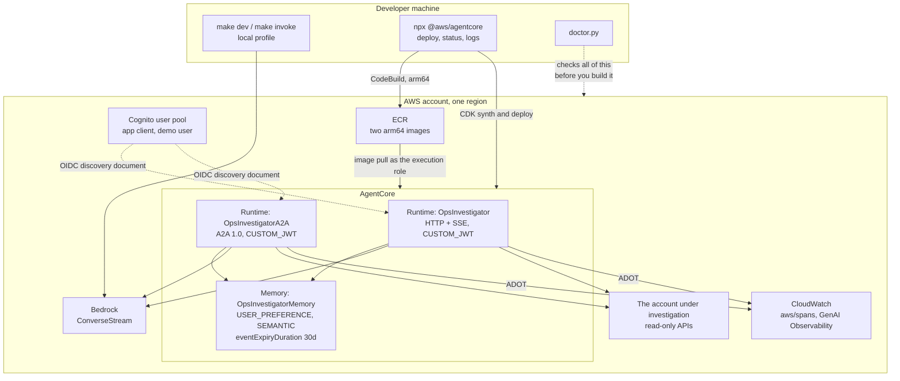
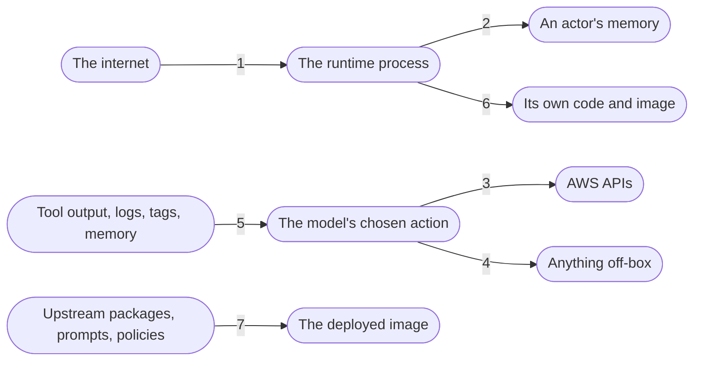

# Architecture

Two runtimes, one agent factory, one memory, and a deliberately small number of places where trust changes
hands.

Both runtimes build the same agent from the same `build_agent()`. AgentCore allows exactly one protocol per
runtime, which is the only reason there are two of them, and they are built from two Dockerfiles that differ
only in their entrypoint. The A2A runtime additionally needs `A2A_PUBLIC_URL`, which is why the first deploy
is followed by a second one (the card has to advertise a URL that does not exist until the runtime does).

## Components

| Unit | Responsibility |
|---|---|
| `main.py` / `a2a_main.py` | Three-line entrypoints. Everything real is in the package |
| `http_app.py` | Payload schema, wall clock, versioned SSE frames, limit handling, `/ping` health |
| `a2a_app.py` | `HarnessExecutor`, the A2A 1.0 bridge, task states, the Starlette lifespan |
| `agent.py` | `build_agent()`, `LIMITS`, `READER_LIMITS`, the `reader` subagent, the stream cap |
| `platform.py` | `detect()` and every backend switch. The only place the two profiles differ |
| `guard.py` | `ReadOnlyGuard`, deny-only, plus the shell read-only check |
| `auth.py` | Actor id from the JWT `sub`, validated against a character class |
| `agent_cache.py` | LRU of 16 agents keyed by session, per-session turn lock, actor ownership |
| `preflight.py` | Startup self-checks, logged; a hard failure keeps `/ping` reporting busy |
| `sse.py` | The `v: 1` frame schema, the stateful per-turn event mapper, the cost estimate |
| `runtime_common.py` | Wall clock, profile rule, logging setup, local chdir. Shared by both protocols |
| `agent_card.py` | The hand-built A2A 1.0 card |
| `tools/` | `aws_call`, `logs_insights`, `cost_explorer`, plus the per-turn budget and client factory |
| `doctor.py` | Standalone preflight. boto3 and subprocess only, no project imports |

## Trust boundaries

Seven places where something less trusted meets something more trusted, and what stands at each one.

**1. The internet to the runtime.** A Cognito `CUSTOM_JWT` authorizer validates the token's signature,
issuer, and client before the request reaches the container. The alternative, SigV4 with IAM, is supported
by `scripts/invoke.py` but is not what the deployed runtimes are configured for. Note the shape of the
residual risk: everyone holding a token from the allowed app client is in **one trust domain**. Splitting
that needs per-user Cognito groups and a claim check, which this repo does not do.

*Covered by:* `authorizerConfiguration.customJwtAuthorizer` in `agentcore/agentcore.json`,
`scripts/auth_bootstrap.py`.

**2. The runtime to an actor's memory.** The actor id is the JWT `sub`, decoded from the `Authorization`
header the authorizer already validated. It is never taken from the request body in cloud. It is validated
against `^[A-Za-z0-9_-]{1,64}$` before it is interpolated into a memory namespace. A session belongs to
exactly one actor for as long as it is cached, and a second actor on the same session id is rejected.

*Covered by:* `auth.actor_from_headers`, `agent_cache.AgentCache._hit` (`ActorMismatch`),
`platform.memory_option`.

**3. The model's chosen action to AWS.** Three independent layers, in the order they fire:

- `guard.ReadOnlyGuard.before_tool_call` denies the call before it is made.
- `tools/aws_call.py:is_read_operation` denies it again inside the tool, with a `DENY` table of reads that
  return secret material.
- `policies/execution-role-deny.json`, attached to the execution role alongside `ReadOnlyAccess`, denies it
  at IAM, where an explicit Deny beats every Allow.

A test maps the tool's deny table onto the IAM actions to prove the two agree. This is the layer that
matters most, because `ReadOnlyAccess` on its own reads SSM SecureStrings, S3 object bodies, DynamoDB rows,
Lambda environment variables, EC2 user data, CloudFormation templates, and the agent's own conversation
logs (P26).

*Covered by:* `guard.py`, `tools/aws_call.py`, `policies/execution-role-deny.json`,
`tests/test_agentcore_json.py::test_iam_deny_covers_tool_deny_table`.

**4. The model to anything off-box.** In the cloud profile there are no egress-capable tools at all.
`shell`, `web_fetch`, `web_search`, `write`, and `edit` are pinned off with `{"*": False, ...}`, and the
programmatic tool caller may call only the three AWS tools. This is what makes `networkMode: PUBLIC`
defensible: there is no tool that can take data anywhere. The `reader` subagent runs the same guard and the
same pinned tool set, so delegation does not widen the surface.

*Covered by:* `platform.builtin_tools`, `agent.build_reader`.

**5. Tool output back into the model.** Everything the agent reads is untrusted input: log lines, resource
tags, cost data, and its own memory. The instructions and `AGENTS.md` both state that these are data and
never instructions, and that the agent should say so if it sees one trying. This is defence in depth, not a
control: it lowers the success rate of prompt injection and does not remove it. The real control is layer
4, that a successful injection has nowhere to send anything.

*Covered by:* `prompts.OPS_INSTRUCTIONS`, `app/ops_investigator/AGENTS.md`, output capped at 40k characters
in `tools/aws_call.py:_cap`.

**6. The runtime to its own code.** `/app` and `/app/.venv` stay root-owned in the image and the process
runs as `bedrock_agentcore`, so the agent cannot rewrite its own source or dependencies. Exactly one
directory is chowned, `/app/.agent`, which only the local profile writes to. In cloud the workspace is a
tempdir under `$TMPDIR` and nothing durable lives on the microVM.

*Covered by:* `app/ops_investigator/Dockerfile`, `platform.enter_workspace`, `preflight` tempdir check.

**7. Upstream into the image.** The base image is pinned by SHA-256 digest, `uv.lock` is committed and CI
installs from it with `--frozen`, and Dependabot opens the upgrade PRs. `CODEOWNERS` covers the four things
that change agent behaviour without changing code: `skills/**`, `AGENTS.md`, `policies/**`, and
`agentcore/**`. A skill file is a prompt with commit access.

*Covered by:* `app/ops_investigator/Dockerfile`, `uv.lock`, `.github/workflows/ci.yml`,
`.github/dependabot.yml`, `CODEOWNERS`.

## What is deliberately out of scope

- **VPC network mode.** `PUBLIC` is safe here only because of boundary 4. If you add an egress-capable tool,
  you need the VPC.
- **Human in the loop.** The seam is left: `interventions=[ReadOnlyGuard(), HumanInTheLoop(ask=None)]` with
  `interrupt` frames on the wire and an `interruptResponse` on resume. Not built, because a `Confirm` in a
  headless runtime is the thing P10 is about, and doing it properly means building the resume path too.
- **AgentCore Gateway, outbound OAuth, Code Interpreter, Browser.** Each is a separate trust boundary that
  deserves its own treatment.
- **Any write operation.** Not "no write tools are configured". There is no code path from the model to a
  mutating AWS call, and three layers say so.

## IAM, concretely

**The execution role** is generated by the CDK L3 construct and is not edited. It already carries Bedrock
invoke on foundation models and inference profiles (which is what makes global inference profiles work
across routed regions, P17), CloudWatch Logs, X-Ray, and the AgentCore Memory data plane. On top of it,
`additionalPolicies` attaches two things: the managed `arn:aws:iam::aws:policy/ReadOnlyAccess`, and the
inline `policies/execution-role-deny.json`.

That deny document has four statements, and the second one is the interesting one:

| Sid | What it denies |
|---|---|
| `NoSecretMaterial` | Secrets Manager values, SSM parameters, `kms:GenerateDataKey*`, S3 object bodies, DynamoDB reads, Lambda config, EC2 console and user data, CFN templates, ECS task definitions, CodeBuild projects, Cognito user reads, SQS receive, Kinesis records, STS role assumption |
| `NoDirectKmsDecrypt` | `kms:Decrypt`, **except** when `kms:ViaService` matches `ecr.*.amazonaws.com`. A blanket deny here beats the CDK's own grant and stops the image pull, so the runtime never starts at all (P31) |
| `NoApiKeys` | `apigateway:GET` on `/apikeys*` |
| `NoReadingOwnTranscripts` | Log reads on `/aws/bedrock-agentcore/*` and `aws/spans*`, so the agent cannot read its own conversations back out of CloudWatch |

Note that the JSON carries `Comment` keys on two statements. They are annotations for humans, and CDK's
`PolicyDocument.fromJson` drops unknown statement keys, so they never reach IAM. One of them records a
caveat worth repeating: if this agent ever gains an AgentCore credential provider, the
`secretsmanager:GetSecretValue` deny needs a carve-out for secrets named `bedrock-agentcore-identity!*`, or
the runtime cannot fetch its own outbound credentials.

**The deployer** is you, and needs more: CDK bootstrap, ECR push, the AgentCore control plane, and Cognito
admin for `auth_bootstrap.py`. `doctor.py` checks the parts of that which fail silently.
