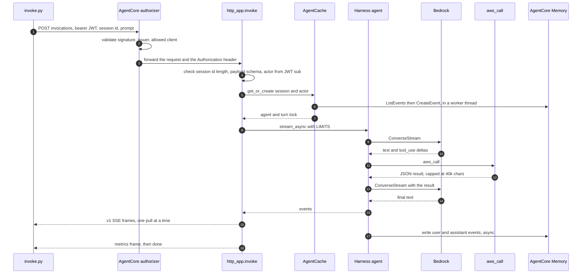

# How a turn flows

One question, from the moment a client sends it to the moment the last frame arrives. This is the HTTP
runtime; the A2A runtime differs only where noted at the end.



## Step by step

**1. The client gets a token and calls the data plane.** `scripts/get_token.py` runs
`USER_PASSWORD_AUTH` against the Cognito app client and prints the access token. `scripts/invoke.py`
generates a 40 character session id (`new_session_id`, because AgentCore's floor is 33) and POSTs
`{"prompt": "..."}` to
`https://bedrock-agentcore.<region>.amazonaws.com/runtimes/<encoded arn>/invocations?qualifier=DEFAULT`
with `Authorization: Bearer <jwt>` and the session id header.

**2. The authorizer validates the token before your code exists.** The `CUSTOM_JWT` authorizer in
`agentcore/agentcore.json` checks the signature against the Cognito discovery document and the token's
client against `allowedClients`. Only because `requestHeaderAllowlist: ["Authorization"]` is set does the
header reach the container at all, and that is the only reason the app can read the actor id.

**3. `invoke` guarantees the shape of the stream.** `http_app.invoke` is the `@app.entrypoint`. It does
nothing but delegate to `_handle` and append exactly one `done` frame, in a `finally` that also closes the
inner generator if the client walks away. Every request, including a request rejected in the first
microsecond, ends with `done`. A client can loop until it sees one.

**4. `_handle` does the four checks, in this order.** Session id length, then payload schema
(`validate_payload`: `prompt` must be a non-empty string under 32 KB, `actor_id` optional, no unknown
keys), then actor identity (`auth.actor_from_headers`, the JWT `sub`, validated against
`^[A-Za-z0-9_-]{1,64}$` because memory namespaces are built from it), then the agent itself. Each failure
is an `error` frame with a `hint`, followed by `done`. Nothing throws.

**5. The agent comes from the cache, or is built in a worker thread.** `AgentCache.get_or_create` returns
the session's agent *and* its turn lock together, so the caller never has to look the entry up again.
On a miss it runs `build_agent` through `asyncio.to_thread`, because the cloud session manager does
`ListEvents` and `CreateEvent` in its constructor and that must not happen on the event loop (P42). A
per-session build lock stops two racing first invokes from building, and billing, twice. If the lock is
already held, the second caller gets `error{busy}` immediately rather than queueing behind an SSE stream
it cannot see.

**6. The turn streams, one pull at a time, under a deadline.** A deadline is computed once
(`loop.time() + MAX_SECONDS`, 600 seconds by default) and each individual pull runs under
`asyncio.wait_for(stream.__anext__(), remaining)`. The timeout scope never crosses a `yield`, which is the
whole point (P36). Events go through one `sse.EventMapper` per turn, which resolves tool names and emits
exactly one `tool_use` frame per call (P35).

**7. The result becomes a metrics frame, and a budget trip gets a closing turn.** The `AgentResult` arrives
as the last stream event rather than as a frame, so `_turn` parks it in a list and `_stream` turns it into
`metrics`. If `stop_reason` starts with `limit_`, the caller gets an `error` frame explaining the budget,
and then one more bounded turn (`turns=1`) asking the agent to summarise what it found. Partial findings
beat a bare budget error.

**8. Memory is written after the fact.** The session manager persists the user and assistant events
asynchronously (`async_mode=True`), so nothing blocks the stream. AgentCore's strategies extract long-term
records into `/preferences/{actor}/` and `/facts/{actor}/` minutes later. The next session for the same
actor sees them through `search_memory`. Spans go to CloudWatch through ADOT, which owns the exporter.

## The frames you will see

The schema is versioned. Every frame carries `"v": 1`, and the mapper drops anything it does not
recognise rather than putting raw Strands events on the wire. To see them literally, run the local server
with `make dev` and then:

```bash title="manual"
uv run python scripts/invoke.py --dev --raw --prompt "List the S3 buckets in this account."
```

The frame types, one example of each:

```json
{"v": 1, "type": "tool_use", "name": "aws_call", "input_keys": ["operation", "service"]}
{"v": 1, "type": "tool_result", "name": "aws_call", "status": "success", "bytes": 412}
{"v": 1, "type": "denied", "tool": "aws_call", "reason": "DENIED: read-only: ec2:terminate_instances is not a permitted read operation"}
{"v": 1, "type": "text", "delta": "This is account 123456789012 in us-west-2."}
{"v": 1, "type": "thinking", "delta": "The user asked for identity first, so..."}
{"v": 1, "type": "metrics", "input_tokens": 3184, "output_tokens": 210, "cache_read_tokens": 0, "cycles": 2, "stop_reason": "end_turn", "est_usd": 0.0126}
{"v": 1, "type": "error", "message": "timeout after 600s", "hint": "narrow the question or raise HARNESS_MAX_SECONDS"}
{"v": 1, "type": "done"}
```

Without `--raw`, `scripts/invoke.py` renders text and thinking inline and brackets everything else:

```
session_id=0123456789abcdef0123456789abcdef01234567
[tool_use] aws_call(operation, service)
[tool_result] aws_call status=success bytes=412
This is account 123456789012 in us-west-2.
[metrics] {"cache_read_tokens": 0, "cycles": 2, "est_usd": 0.0126, "input_tokens": 3184, "output_tokens": 210, "stop_reason": "end_turn"}
```

Four things about these frames are worth knowing before you build a client on them.

**`input_keys`, not input.** A `tool_use` frame reports which keys the tool was called with and never
their values. A prompt-injected argument cannot leak through telemetry it never enters.

**`bytes`, not content, and it comes from a hook.** A `tool_result` frame reports the size of what came
back, its status, and the tool's name. It is not mapped from a stream event, because there is no such
event: `ToolResultEvent` is not a callback event, so `stream_async` never yields one (P51).
`tool_events.ToolResultRecorder` records every finished call from the SDK's `AfterToolCallEvent` hook, and
`http_app._turn` drains that buffer between stream events — so the frame lands right after the `tool_use`
frame for the same call, and before whatever the model said next. On the cloud profile there is one
exception: `programmatic_tool_caller` runs the calls the agent writes in code through the executor itself
and consumes their events, so those arrive as `tool_result` frames with no preceding `tool_use` frame.

**`denied{tool, reason}`, then an error `tool_result`.** A `ReadOnlyGuard` refusal produces a `tool_use`
frame, then a `denied` frame, then a `tool_result` frame with `status=error` for the same call. The
`denied` frame is sourced from the SDK's `tool_cancel_event` — the event `ToolExecutor._stream` yields
between the intervention's `Deny` and the error `ToolResult` it synthesises — mapped by
`sse.EventMapper._map_tool_cancel`, with `reason` truncated to 300 characters and deduplicated per
`toolUseId`. `scripts/invoke.py` renders it as `[denied] <tool>: <reason>`. A successful call has no
`denied` frame in between: it is `tool_use`, then `tool_result` with `status=success`. A denial inside
`programmatic_tool_caller` has no streamed cancel event to map, so the after-tool hook carries that one
too, and it reaches the caller as the same pair of frames.

**`est_usd` can be `null`.** `sse.estimate_usd` matches the model id against a small price table of
`sonnet`, `opus`, and `haiku`. A model outside those families logs a warning and reports `null` rather
than a wrong number.

## Where the A2A path differs

Same `build_agent`, same cache, same wall clock, different wire.

- The A2A **context id is the AgentCore session id**, so it inherits the 33 character floor.
- There is no SSE stream to lose, so a second caller on a busy context **queues for the turn lock**
  instead of being told `busy`. The deadline starts when the request arrives, so the wait is inside the
  same budget rather than on top of it.
- The answer is published as **one artifact at the end of the turn**, named `answer`, with status updates
  (`SUBMITTED`, `WORKING`, `COMPLETED`) along the way. Incremental artifact chunks are a follow-up.
- **Every failure is a task state**, never a transport error. `execute()` cannot raise. An unusable message
  is `REJECTED`, a wall-clock trip is `FAILED`, a budget trip completes with a message saying the findings
  are partial.

Read `a2a_app.HarnessExecutor.execute` and `._turn` next to `http_app._handle`; they are deliberately the
same shape.
