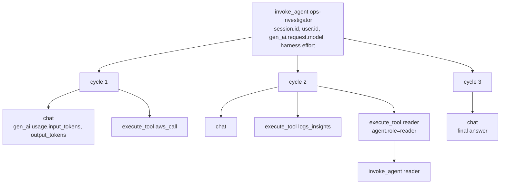

# Reading the traces

Getting traces to appear at all is three separate settings, any one of which silently produces nothing.
Once they appear, this is what you are looking at.

## First, make them exist

**CloudWatch Transaction Search, once per region.** Without it, spans are written and nothing indexes them,
so the GenAI Observability views stay empty while X-Ray looks fine.

Enabling it is not the same as it working. In this repo's first cloud run the destination read
`CloudWatchLogs` / `ACTIVE` with a 100% indexing rule, and `aws/spans` still held not one span from either
runtime 59 minutes later, while X-Ray held 95 traces naming them. **Check X-Ray first, and use the X-Ray trace view** — it
answers immediately and is the view every example below assumes. GenAI Observability is the richer view,
once Transaction Search actually delivers. See PITFALLS P59.

```bash title="manual"
aws xray update-trace-segment-destination --destination CloudWatchLogs --region us-west-2
```

`doctor.py:_transaction_search_check` calls `GetTraceSegmentDestination` and FAILs with exactly that
command when `Status` is not `ACTIVE` and `Destination` is not `CloudWatchLogs`.

**ADOT must wrap the process.** The image's entrypoint is
`CMD ["opentelemetry-instrument", "python", "-m", "main"]`. Not a library call inside the app, a wrapper
around it.

**`OTEL_TRACES_EXPORTER` must be left to ADOT.** `agentcore/agentcore.json` never sets it — but ADOT sets
it itself, to `otlp`, before your code runs: `opentelemetry-instrument` loads the distro, and under
AgentCore's agent-observability mode the distro does `os.environ.setdefault(OTEL_TRACES_EXPORTER, "otlp")`.
So the healthy container has it *set*, and `preflight.run_preflight` logs
`otel_exporter=PASS otlp; ADOT owns tracing`. It WARNs on any other value, because that means something
took the exporter away from ADOT and the Strands telemetry module will build its own and compete for the
tracer provider — at which point you get no spans, or two copies of some. It also WARNs when the variable
is *unset* in the cloud, because that means the distro never loaded at all. See PITFALLS P56.

All three together are P8. If your traces are missing, check them in that order.

## The span tree

One invocation produces one tree. Names are the harness's, except the root, which is your agent's `name`.



**`invoke_agent ops-investigator`** is the root, and there should be **exactly one per invocation**. Two
means you built the agent twice, which usually means the cache missed when it should not have. The cloud
smoke counts them with a Logs Insights query against `aws/spans`, and counts X-Ray traces alongside it so
that a zero here reads as "not indexed yet" rather than "not instrumented" (P59):

```
fields name | filter name like /invoke_agent ops-investigator/ | stats count() as n
```

**`cycle N`** is one iteration of the agent loop: think, maybe call tools, repeat. The cycle count is also
reported on the wire in the `metrics` frame, so you can compare what the client saw against what the trace
recorded without leaving the terminal.

**`chat`** is the Bedrock call. This is where the token counts live, and where latency usually is.

**`execute_tool <name>`** is one tool call. A `reader` delegation shows up as an `execute_tool reader` span
with a whole nested `invoke_agent reader` tree underneath it, which is the clearest way to see how much of
a turn a subagent actually consumed.

## The attributes we set, and why

`agent.build_agent` passes four `trace_attributes`, and every span in the tree inherits them.

| Attribute | Value | What it is for |
|---|---|---|
| `session.id` | The AgentCore `runtimeSessionId` | Filter a whole conversation. This is the only way to see turn two of a session next to turn one |
| `user.id` | The JWT `sub` | Whose turn it was. The same string that namespaces their memory, so a memory question and a trace question use the same key |
| `gen_ai.request.model` | `bedrock/global.anthropic.claude-sonnet-4-6` | Which model this turn actually used, after `HARNESS_MODEL` was applied |
| `harness.effort` | `medium` | Which effort level, which is most of the difference between a cheap turn and an expensive one |

The `reader` subagent overrides these with `session.id` plus `agent.role: "reader"`, so a subagent's spans
are distinguishable from its parent's without reading the tree structure.

### The conversation is recorded, and it is not in X-Ray

**Strands records the conversation as span events** — `gen_ai.system.message`, `gen_ai.user.message`,
`gen_ai.assistant.message`, `gen_ai.tool.message` and `gen_ai.choice`: the system prompt, the user prompt,
the model's reasoning, tool arguments, tool results and the answer. They land in the **runtime log group's
`spans` stream**, which AgentCore creates with retention **never expire**. X-Ray segment documents do not
show them, because ADOT's LLO handler lifts content off the span on the OTLP path — so the content is in
CloudWatch Logs, not in X-Ray. Looking only at X-Ray is what makes a reader conclude there is none.

The attribute table above is what is on the span. The conversation is in the events beside it. Measured on
this deployment over two hours: 71 spans carrying those events across the two runtimes, 225 events, about
320 KB of prompt, reasoning, tool-argument and answer text. A single `chat` span's
`gen_ai.system.message` was 3.2 KB of system prompt. PITFALLS P61 has the measurement method, including
the two traps that make it easy to miss.

Read them with Logs Insights over the runtime log group:

```
filter @logStream = 'spans' and @message like /gen_ai.user.message/ | stats count() as spans by name
```

There is no off switch wired up in this repo. Do not reach for
`AWS_GENAI_CONTENT_EXTRACTION_OPT_OUT`: it does not control whether content is *recorded*, only where it
*goes*. Unset (the default), the AWS OTLP span exporter runs ADOT's LLO handler, which lifts content off
the span into a consolidated Gen AI Event log record. Set to `true`, that handler is skipped and spans are
exported unmodified — so opting "out" leaves **more** content on the span, not less. Strands' own
redaction control is `OTEL_SEMCONV_STABILITY_OPT_IN` (`gen_ai_latest_experimental` plus
`gen_ai_unredacted_attributes`), and by its own docstring it governs the *latest-convention span
attributes*, not the legacy message events above. **That path is untested here** — it needs a redeploy and
a re-measurement — so treat it as a follow-up, not as a setting you can rely on. For v0.1 the practical
control is retention: set one on both runtime log groups after the first deploy (P61).

The `user_agent_extra` on every boto3 client (`strands-harness-on-aws session=<id> actor=<id>`, set in
`tools/_clients.py:client_config`) puts the same two ids into CloudTrail, so a trace and an API call log
can be correlated without either of them carrying data.

## Where cost shows up

Two places, and they measure different things.

**In the stream, immediately.** The `metrics` frame at the end of every turn:

```json
{"v": 1, "type": "metrics", "input_tokens": 3184, "output_tokens": 210, "cache_read_tokens": 2048, "cycles": 2, "stop_reason": "end_turn", "est_usd": 0.0126}
```

`est_usd` comes from `sse.estimate_usd`, which matches the model id against a three-family price table and
multiplies. It is an estimate, it is computed locally, and it is `null` for any model family it does not
recognise, which is deliberate: a wrong number is worse than no number. `cache_read_tokens` is worth
watching, because prompt caching (`caching="auto"`) is most of the saving on a multi-turn investigation.

**In CloudWatch GenAI Observability, once Transaction Search delivers.** The console's model invocation
views aggregate token counts and cost per model across invocations, built from the `gen_ai.usage.*`
attributes on the `chat` spans. They read the same `aws/spans` index that can stay empty for tens of
minutes after Transaction Search is enabled, so do not read an empty panel as a broken agent — check X-Ray
first (P59). Use the stream's `est_usd` while you are iterating, and the console when you want to know what
a day of demos actually cost.

`stop_reason` is the field to check first when a turn ends oddly. Anything starting with `limit_` means a
budget trip, and the app will have emitted an `error` frame and run one bounded closing turn before `done`.

## The log lines worth grepping

```bash title="manual"
make logs                     # agentcore logs --runtime OpsInvestigator
```

Only the `ops_investigator` package logs at `INFO`; the SDKs stay at `WARNING`
(`runtime_common.configure_logging`). That is a deliberate choice, and without it the container log is
empty, because neither `BedrockAgentCoreApp` nor uvicorn installs a handler for your package (P49).

| Line | Logger | What it tells you |
|---|---|---|
| `preflight profile=PASS cloud` | `ops_investigator.preflight` | Which profile the container decided it was in. First thing to check when memory is not working |
| `preflight model=PASS bedrock/...` | `ops_investigator.preflight` | The one-token `ConverseStream` succeeded. A WARN here carries the console fix in the same line |
| `preflight tempdir=FAIL ...` | `ops_investigator.preflight` | P2. The workspace is not writable and every turn will fail |
| `turn start session=... actor=... prompt_bytes=...` | `ops_investigator.http` | One per invocation. Count these against `invoke_agent` spans |
| `guard.denied tool=aws_call reason=read-only: s3:delete_bucket is not a permitted read operation` | `ops_investigator.guard` | **The line to put on screen during a demo.** One per refusal, with the exact tool and reason |
| `agent cache over 16 entries: every cached session is mid-turn` | `ops_investigator.cache` | Concurrency higher than the cache was sized for. The cache runs over rather than killing a live turn |
| `agent construction failed session=...` | `ops_investigator.http` | The session manager could not initialise, usually memory permissions. The caller got `agent unavailable` |

`guard.denied` is the one to demo. Ask the agent to delete something, and the refusal appears in the log as
a structured line at the same moment the model explains itself in the text stream. Two independent records
of the same decision, one for the user and one for whoever reviews the account later.
