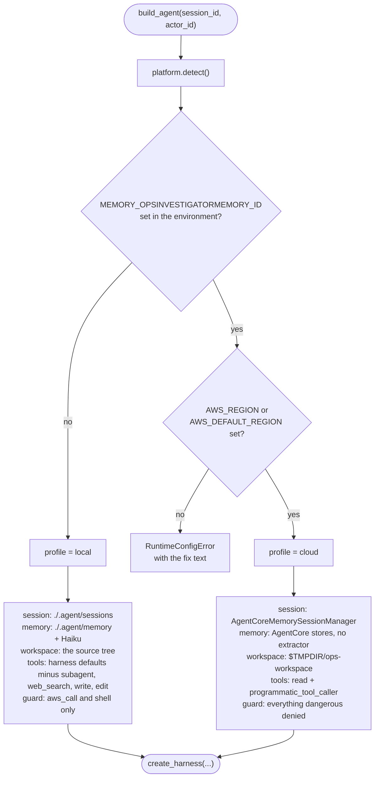

# Why each switch

`create_harness()` has good defaults. They are defaults for a developer at a terminal, and about half of
them are wrong for a hosted runtime. This page walks every one this repo changes: what the harness does on
its own, why that breaks on AgentCore, and the exact kwarg we pass instead.

All of it is decided in one place. `platform.detect()` returns a `Runtime` dataclass, `agent.build_agent()`
reads it, and there is no other branch anywhere in the app.



The profile is decided by one environment variable, and that variable is injected by the CDK stack when it
wires the memory to the runtime. There is no `IS_CLOUD` flag to forget to set, and no way to be in the
cloud without a memory to write to.

---

## `session`

**Harness default.** A file-backed session store under `./.agent/sessions/`, keyed by a session id.

**Why it breaks.** The container's `/app` is root-owned and the process is not root, so the write fails
outright. Even if it succeeded, the microVM is ephemeral: the next turn on the same session can land on a
different machine with an empty disk (P2).

**What we pass.**

```python
# cloud, platform.session_option
AgentCoreMemorySessionManager(
    AgentCoreMemoryConfig(
        memory_id=rt.memory_id,
        session_id=rt.session_id,
        actor_id=rt.actor_id,
        retrieval_config=None,           # single reader: the harness stores (P3)
        async_mode=True,                 # never block the SSE stream (P14)
        filter_restored_tool_context=True,  # dead offload references after a restart (P23)
    ),
    rt.region,
)

# local, platform.session_option
{"id": rt.session_id, "dir": str(rt.app_dir / ".agent" / "sessions")}
```

Three flags, three separate traps. `retrieval_config=None` because the session manager will *also* inject
retrieved memories if you let it, and then you have two readers (P3). `async_mode=True` because the sync
path drops in-flight writes and blocks the stream while it flushes (P14), which in turn makes `agent(...)`
illegal everywhere (P43). `filter_restored_tool_context=True` because offloaded tool results live in a
`tempfile.mkdtemp` that does not survive the microVM they were written on (P23).

The constructor is not free: it does `ListEvents` and, for a new session, `CreateEvent`. That is why
`build_agent` runs in a worker thread (P42).

---

## `memory`

**Harness default.** A file store plus its own extractor, which runs Haiku 4.5 over each turn to decide
what is worth remembering.

**Why it breaks.** Nothing breaks; it works, and that is the problem. AgentCore's strategies also extract,
server-side, into the namespaces you declared. Leave both on and every fact is written twice by two models
with two opinions, and you pay for a model you never chose (P3, P4).

**What we pass.**

```python
# cloud, platform.memory_option
{"stores": create_agentcore_memory_stores(
    memory_id=rt.memory_id,
    actor_id=rt.actor_id,
    session_id=rt.session_id,
    namespaces=[
        {"namespace": f"/preferences/{rt.actor_id}/", "name": "preferences", "max_search_results": 5},
        {"namespace": f"/facts/{rt.actor_id}/", "name": "facts", "max_search_results": 5},
    ],
    extraction=False,                    # AgentCore strategies are the single writer (P3)
    region_name=rt.region,
)}

# local, platform.memory_option
{"dir": str(rt.app_dir / ".agent" / "memory")}
```

`extraction=False` yields read-only stores. The resulting `MemoryManager` exposes `search_memory` and
nothing else, and no Haiku client is constructed. The write side is entirely AgentCore: the
`USER_PREFERENCE` and `SEMANTIC` strategies declared in `agentcore/agentcore.json`, whose
`namespaceTemplates` use `{actorId}` and so match the namespaces above exactly.

Locally the harness defaults stand, deliberately. The demo can show both modes, and you can open the JSON
under `app/ops_investigator/.agent/memory/` and read what the harness thought was worth keeping.

The namespaces are built from the actor id, which is the JWT `sub`. That is the whole of the multi-tenancy
story here, and it is why `auth.py` validates the actor against a character class before it is ever
interpolated into a path.

---

## `skills`

**Harness default.** Skills are discovered relative to the working directory, and fetched skills are
cached under `./.agent/`.

**Why it breaks.** The same read-only `/app` problem, and worse: in cloud the working directory is a
tempdir, so a relative lookup finds nothing at all.

**What we pass.**

```python
# both profiles, platform.skills_option
str(rt.app_dir / "skills")               # an absolute path, resolved from __file__
```

An absolute path, computed from the module's own location, so it is correct whatever the cwd is. The
consequence lands in the Dockerfile: `skills/` and `AGENTS.md` are not in the wheel
(`[tool.hatch.build.targets.wheel] packages = ["ops_investigator"]`), so the image must `COPY . .` the
whole app directory and not just install the package. Install only the wheel and the skill silently
disappears in cloud, with no error anywhere.

---

## `builtin_tools`

**Harness default.** `shell`, `read`, `write`, `edit`, `web_fetch`, `web_search`, `subagent`,
`todo_write`, `search_memory`, `programmatic_tool_caller`, `retrieve_offloaded_content`.

**Why it breaks.** On a `PUBLIC` network runtime, `shell` and `web_fetch` are an exfiltration channel: any
instruction the model picks up from a log line or a resource tag can be acted on. `write` and `edit` have
no read-only use at all. And `web_search` is not available on Bedrock, so naming it raises (P19).

**What we pass.**

```python
# cloud, platform.builtin_tools
{
    "*": False,
    "read": True,
    "programmatic_tool_caller": {
        "allowed_tools": ["aws_call", "logs_insights", "cost_explorer"],
        "timeout": 60,
    },
}

# local, platform.builtin_tools
{"subagent": False, "web_search": False, "write": False, "edit": False}
```

The leading `{"*": False}` is the entire point, and it is the easiest thing in this file to get wrong.
**A mapping edits the defaults, it does not replace them** (P21). `{"read": True}` on its own leaves
`shell`, `write`, `edit`, and `web_fetch` exactly where they were, and your carefully restricted agent has
a shell. Only a list, or a mapping that starts by turning everything off, pins the set.

The local dict is a patch on purpose: `shell` stays, because reading `aws` output at a terminal is what
local development is for, and `guard.shell_is_read_only` vets it. `write` and `edit` go in both profiles,
because there is no version of this agent that should edit files.

`programmatic_tool_caller` gets an explicit `allowed_tools` list rather than the default, so the code path
that can call tools in a loop can only reach the three that are already allowlisted.

---

## `interventions`

**Harness default.** None. The documented way to add one is a policy string, for example
`interventions="never delete anything"`.

**Why it breaks.** That string is not a rule, it is a prompt. The harness builds an LLM classifier from it,
and the classifier's answer is `Confirm`, which raises an interrupt and waits for a human to approve. In a
headless runtime nobody approves it, the turn hangs, and the pending interrupt is persisted with the
session, so resuming the session hits the same wall (P10).

**What we pass.**

```python
# both profiles, agent.build_agent
interventions=[platform.guard_for(rt)]

# platform.guard_for
ReadOnlyGuard() if rt.profile == "cloud" else ReadOnlyGuard(denied_tools=frozenset())
```

`ReadOnlyGuard` is a deterministic `InterventionHandler`. Its `before_tool_call` returns `Deny` or
`Proceed` and there is no code path that can produce a `Confirm`; a test asserts exactly that. It denies
the dangerous builtins by name, denies any `aws_call` whose `(service, operation)` is not a permitted read,
and denies a `shell` command that is not a single plain read-only `aws` invocation. A non-dict tool input
is denied outright, so a malformed call fails closed rather than falling through.

In cloud the dangerous tools are already off (P21), so the guard's `denied_tools` set is belt and braces.
Locally they are on, and the guard is what makes them safe, so the local instance is constructed with an
empty `denied_tools` set and relies on the per-tool checks instead. Subclassing `InterventionHandler`
requires a `name` class attribute, which is abstract on the base (P34).

---

## `workspace` and the working directory

**Harness default.** The process's cwd, whatever that happens to be.

**Why it breaks.** In cloud, cwd is `/app`, which is read-only for the runtime user. Locally, cwd is
wherever you ran `make` from, which is the repo root, and the harness `environment` plugin reads `AGENTS.md`
from cwd, so the agent silently loses its environment notes.

**What we pass.** Not a kwarg at all. `platform.enter_workspace(rt)` chdirs before `create_harness()` is
called:

```python
# cloud
workspace = Path(tempfile.gettempdir()) / "ops-workspace"
workspace.mkdir(parents=True, exist_ok=True)
shutil.copyfile(app_dir / "AGENTS.md", workspace / "AGENTS.md")
os.chdir(workspace)

# local, runtime_common.enter_local_app_dir
os.chdir(platform.APP_DIR)
```

`AGENTS.md` is copied, not linked, because the plugin reads it from cwd and cwd is now somewhere else.
`preflight` asserts the tempdir is writable at startup so this fails on the health check rather than
halfway through a paid turn.

---

## The two that are not switches

**`model` and `effort`.** The harness defaults to Opus 5 at effort `high`, which is a fifteen dollar demo
(P6). We pass `bedrock/global.anthropic.claude-sonnet-4-6` at `medium`, both overridable by
`HARNESS_MODEL` and `HARNESS_EFFORT`. The model is always a `provider/name` **string**, never a
constructed `BedrockModel`: passing your own `boto_client_config` silently drops the harness's 120 second
read timeout (P11), and the string path keeps the harness's effort mapping, thinking budget, and cache
points.

**`limits`.** `Limits(turns=25, output_tokens=60_000, total_tokens=1_500_000)`, and only those three keys
exist. Anything else you pass is accepted and ignored (P12), which is why a test compares the key set
against the dataclass annotations. `Limits` is an argument to `stream_async`, not agent state, so the
`reader` subagent needs its own: the harness's subagent tool calls the child with no limits at all, and the
`Agent` constructor has no `limits` keyword, so `agent._cap_stream` wraps the child's `stream_async` with a
floor (P33).

## The rest of the call

For completeness, the kwargs `build_agent` passes that are *not* fighting a default:

| Kwarg | Value | Why |
|---|---|---|
| `tools` | `[aws_call, logs_insights, cost_explorer, reader]` | The three AWS tools plus the subagent |
| `mcp_servers` | `None`, or AWS docs over streamable HTTP when `ENABLE_AWS_DOCS_MCP=1` | Opt-in, with `continue_on_error` (P13) |
| `background_tasks` | `{"agentic": [], "max_concurrency": 2, "timeout": 300}` | No agentic background work; a bounded pool for the rest |
| `caching` | `"auto"` | Prompt caching is most of the cost saving on a multi-turn investigation |
| `context_manager` | `"auto"` | Long tool outputs need compaction, and the harness does it better than we would |
| `name` | `"ops-investigator"` | This becomes the span name: `invoke_agent ops-investigator` |
| `trace_attributes` | `session.id`, `user.id`, `gen_ai.request.model`, `harness.effort` | See [reading-the-traces.md](reading-the-traces.md) |
| `instructions` | `OPS_INSTRUCTIONS`, plus `LOCAL_TOOLS_NOTE` in local | The prompt must describe the tools the agent actually has, and the two profiles differ |
